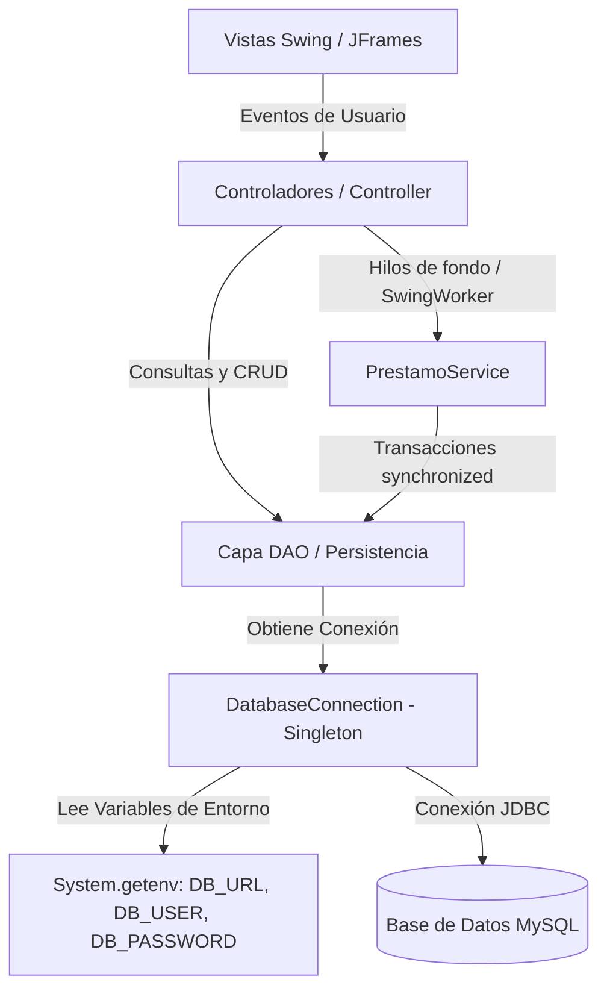

# 🧠 EFT – Desarrollo Orientado a Objetos II
### Sistema de Gestión de Biblioteca Escolar

## 👤 Información del Estudiante y Asignatura
- **Nombre completo:** Valentina Segura Vargas
- **Sección:** 0007A
- **Carrera:** Analista Programador Computacional
- **Sede:** Virtual
- **Asignatura:** Desarrollo Orientado a Objetos II
- **Evaluación:** Evaluación Final Transversal (EFT)

---

## 📘 Descripción General del Sistema

El **Sistema de Gestión de Biblioteca Escolar** es una aplicación de escritorio desarrollada en **Java (Swing)** y persistencia relacional en **MySQL**, orientada a resolver las problemáticas operativas de una biblioteca educativa:
- Centralización y administración del inventario de libros y categorías bibliográficas.
- Registro, actualización y seguimiento de estudiantes.
- Control seguro y consistente del ciclo de préstamos y devoluciones de ejemplares, evitando inconsistencias de stock ante accesos concurrentes.
- Emisión de reportes de gestión (libros más solicitados, préstamos vencidos, historial por estudiante o RUT).
- Control de acceso basado en roles (`bibliotecario` y `estudiante`), garantizando que cada usuario acceda únicamente a los módulos autorizados.

La solución aplica de forma rigurosa los estándares de la Programación Orientada a Objetos (POO), patrones de arquitectura y diseño de software (**MVC**, **DAO**, **Singleton**), y mecanismos de concurrencia para mantener una interfaz gráfica reactiva y un modelo de datos atómico.

---

## 👥 Roles y Módulos Funcionales

El sistema provee autenticación centralizada mediante credenciales (RUT y contraseña) y segmenta sus funciones de acuerdo con el rol asignado en la base de datos:

### 1. Rol Bibliotecario (Administración Completa)
- **Gestión de Libros (`LibroFrame`):** CRUD completo (Crear, Listar, Actualizar, Eliminar) de libros, asignación de categorías, control de stock y estado de disponibilidad.
- **Gestión de Estudiantes (`EstudianteFrame`):** CRUD de estudiantes con validación de datos (Nombre, RUT, Curso, Correo institucional).
- **Préstamos y Devoluciones (`PrestamoFrame`):** Registro de nuevos préstamos con fecha de préstamo y vencimiento (7 días), validación automática de stock disponible, y procesamiento de devoluciones restaurando el inventario disponible.
- **Módulo de Reportes (`ReporteFrame`):** Visualización de métricas clave:
  - Ranking de libros más prestados.
  - Listado de préstamos vencidos y activos.
  - Historial detallado de préstamos por estudiante.

### 2. Rol Estudiante (Consulta y Autoservicio)
- **Catálogo y Mis Préstamos (`CatalogoFrame`):**
  - Consulta del catálogo bibliográfico completo en tiempo real.
  - Búsqueda y visualización de su historial personal de préstamos mediante su RUT.

---

## 📐 Patrones de Diseño y Arquitectura



### 1. Modelo - Vista - Controlador (MVC)
- **Modelo (`src/model`):** Clases de dominio que encapsulan el estado y comportamiento de los objetos del negocio (`Persona`, `Usuario`, `Estudiante`, `Libro`, `Categoria`, `Prestamo`).
- **Vista (`src/view`):** Interfaces gráficas basadas en `JFrame` y componentes Swing (`LoginFrame`, `MainMenuFrame`, `LibroFrame`, `EstudianteFrame`, `PrestamoFrame`, `CatalogoFrame`, `ReporteFrame`).
- **Controlador (`src/controller`):** Clases intermediarias que procesan los eventos de la vista, delegan la lógica a los DAOs o servicios y actualizan la interfaz gráfica (`AuthController`, `CatalogoController`, `EstudianteController`, `LibroController`, `PrestamoController`, `ReporteController`).

### 2. Data Access Object (DAO)
- Se aísla toda la lógica de acceso a datos y sentencias SQL (`src/dao`), desacoplando el motor de persistencia MySQL de la lógica de negocio y las vistas.
- Clases DAO implementadas: `AuthDAO`, `CategoriaDAO`, `EstudianteDAO`, `LibroDAO`, `PrestamoDAO`, `ReporteDAO`, `UsuarioDAO`.

### 3. Singleton (`DatabaseConnection`)
- Implementado en `src/config/DatabaseConnection.java` para asegurar la existencia de una única instancia gestora de conexiones JDBC en toda la ejecución.
- Posee constructor privado, método estático `getInstance()` y método `conectar()` que obtiene las credenciales seguras desde el entorno del sistema.

### 4. Capa de Servicio Transaccional (`PrestamoService`)
- Ubicado en `src/service/PrestamoService.java`, centraliza las operaciones transaccionales complejas que involucran múltiples tablas (`prestamos` y `libros`), gestionando transacciones atómicas con `setAutoCommit(false)`, `commit()` y `rollback()`.

---

## 🧬 Principios de Programación Orientada a Objetos (POO)

1. **Abstracción:**
   - La clase `Persona` (`src/model/Persona.java`) se define como abstracta (`public abstract class Persona`), estableciendo la estructura base y declarando el método abstracto `public abstract String mostrarInformacion();`.
2. **Herencia:**
   - Las clases `Usuario` y `Estudiante` extienden de `Persona` (`extends Persona`), reutilizando los atributos comunes (`id`, `nombre`, `rut`, `correo`) e invocando al constructor padre mediante `super(...)`.
3. **Polimorfismo:**
   - Las subclases `Usuario` y `Estudiante` implementan su propia versión de `mostrarInformacion()` mediante la anotación `@Override`, adaptando el formato de salida a sus campos particulares (`rol` en `Usuario`, `curso` en `Estudiante`).
4. **Encapsulamiento:**
   - Todos los atributos de las entidades poseen modificador de acceso `private` y se exponen de forma segura mediante métodos accesores (*getters*) y mutadores (*setters*).

---

## ⚡ Concurrencia, Hilos y Manejo de Consistencia

### 1. Interfaz Gráfica Reactiva (`SwingWorker`)
Para evitar el congelamiento de la interfaz de usuario (*UI freeze*) durante consultas o escrituras en la base de datos, los controladores ejecutan las operaciones I/O en hilos de fondo mediante `javax.swing.SwingWorker`:
- `doInBackground()`: Ejecuta la consulta JDBC en un hilo de trabajo en segundo plano.
- `done()`: Retorna el resultado al hilo despachador de eventos de Swing (**Event Dispatch Thread - EDT**) para actualizar tablas y componentes visuales de manera segura.

### 2. Sincronización y Exclusión Mutua (`synchronized`)
Para prevenir condiciones de carrera (*race conditions*) cuando múltiples usuarios o hilos intentan solicitar el último ejemplar disponible de un libro simultáneamente:
- Los métodos `prestarLibro(...)` y `devolverLibro(...)` en `PrestamoService` están definidos con la palabra clave `synchronized`.
- Garantiza que la verificación de stock, inserción del préstamo y decremento/incremento de unidades se ejecuten como operaciones críticas indivisibles.

### 3. Integridad Transaccional (ACID)
- Se desactiva el autoguardado (`conexion.setAutoCommit(false)`).
- Si la verificación de stock o cualquier sentencia SQL falla, se invoca `conexion.rollback()`, asegurando que no se registren préstamos huérfanos ni inconsistencias de inventario.
- Tras completarse todas las operaciones exitosamente, se consolida la transacción con `conexion.commit()`.

---

## 🧱 Estructura del Proyecto

```plaintext
BibliotecaEscolar/
├── modules/
│   └── mysql-connector-j-26.7.0.jar      # Conector JDBC oficial de MySQL
├── src/
│   ├── config/
│   │   └── DatabaseConnection.java       # Patrón Singleton y conexión JDBC con variables de entorno
│   ├── controller/
│   │   ├── AuthController.java           # Control de inicio de sesión
│   │   ├── CatalogoController.java       # Manejo asíncrono del catálogo de estudiantes
│   │   ├── EstudianteController.java     # Gestión asíncrona de estudiantes
│   │   ├── LibroController.java          # Gestión asíncrona de libros
│   │   ├── PrestamoController.java       # Gestión asíncrona de préstamos y devoluciones
│   │   └── ReporteController.java        # Generación de reportes y consultas
│   ├── dao/
│   │   ├── AuthDAO.java                  # Validación de credenciales y roles
│   │   ├── CategoriaDAO.java             # CRUD y listado de categorías
│   │   ├── EstudianteDAO.java            # CRUD de estudiantes
│   │   ├── LibroDAO.java                 # CRUD y búsqueda de libros
│   │   ├── PrestamoDAO.java              # Consultas y listados de préstamos
│   │   ├── ReporteDAO.java               # Consultas avanzadas y estadísticas
│   │   └── UsuarioDAO.java               # Persistencia de usuarios del sistema
│   ├── model/
│   │   ├── Categoria.java                # Entidad de categoría bibliográfica
│   │   ├── Estudiante.java               # Subclase de Persona (herencia y polimorfismo)
│   │   ├── Libro.java                    # Entidad de libro e inventario
│   │   ├── Persona.java                  # Clase abstracta base
│   │   ├── Prestamo.java                 # Entidad de préstamo y estado
│   │   └── Usuario.java                  # Subclase de Persona con credenciales y rol
│   ├── service/
│   │   └── PrestamoService.java          # Lógica transaccional sincronizada (synchronized + ACID)
│   ├── view/
│   │   ├── CatalogoFrame.java            # Vista del catálogo para estudiantes
│   │   ├── EstudianteFrame.java          # Vista de gestión de estudiantes
│   │   ├── LibroFrame.java               # Vista de gestión de libros
│   │   ├── LoginFrame.java               # Ventana de autenticación
│   │   ├── MainMenuFrame.java            # Menú principal dinámico según rol
│   │   ├── PrestamoFrame.java            # Vista de préstamos y devoluciones
│   │   └── ReporteFrame.java             # Vista de reportes y gráficos/tablas
│   └── Main.java                         # Punto de entrada de la aplicación
├── BibliotecaEscolar.iml                  # Archivo de módulo IntelliJ IDEA
└── README.md                             # Documentación técnica y guía de ejecución
```

---

## 🗄️ Esquema de la Base de Datos Relacional (MySQL)

El sistema utiliza las siguientes tablas relacionales en MySQL:

```sql
CREATE DATABASE IF NOT EXISTS biblioteca_escolar CHARACTER SET utf8mb4 COLLATE utf8mb4_unicode_ci;
USE biblioteca_escolar;

-- Tabla de Categorías
CREATE TABLE IF NOT EXISTS categorias (
    id INT AUTO_INCREMENT PRIMARY KEY,
    nombre VARCHAR(100) NOT NULL,
    descripcion TEXT
);

-- Tabla de Usuarios del Sistema (Bibliotecarios / Estudiantes)
CREATE TABLE IF NOT EXISTS usuarios (
    id INT AUTO_INCREMENT PRIMARY KEY,
    nombre VARCHAR(100) NOT NULL,
    rut VARCHAR(20) NOT NULL UNIQUE,
    correo VARCHAR(100) NOT NULL,
    contraseña VARCHAR(255) NOT NULL,
    rol ENUM('bibliotecario', 'estudiante') NOT NULL
);

-- Tabla de Estudiantes
CREATE TABLE IF NOT EXISTS estudiantes (
    id INT AUTO_INCREMENT PRIMARY KEY,
    nombre VARCHAR(100) NOT NULL,
    rut VARCHAR(20) NOT NULL UNIQUE,
    curso VARCHAR(50) NOT NULL,
    correo VARCHAR(100) NOT NULL
);

-- Tabla de Libros
CREATE TABLE IF NOT EXISTS libros (
    id INT AUTO_INCREMENT PRIMARY KEY,
    titulo VARCHAR(150) NOT NULL,
    autor VARCHAR(100) NOT NULL,
    isbn VARCHAR(30) NOT NULL UNIQUE,
    id_categoria INT,
    stock INT NOT NULL DEFAULT 0,
    disponible BOOLEAN NOT NULL DEFAULT TRUE,
    FOREIGN KEY (id_categoria) REFERENCES categorias(id) ON DELETE SET NULL
);

-- Tabla de Préstamos
CREATE TABLE IF NOT EXISTS prestamos (
    id INT AUTO_INCREMENT PRIMARY KEY,
    id_estudiante INT NOT NULL,
    id_libro INT NOT NULL,
    fecha_prestamo DATE NOT NULL,
    fecha_devolucion DATE NOT NULL,
    devuelto BOOLEAN NOT NULL DEFAULT FALSE,
    FOREIGN KEY (id_estudiante) REFERENCES estudiantes(id) ON DELETE CASCADE,
    FOREIGN KEY (id_libro) REFERENCES libros(id) ON DELETE CASCADE
);
```

---

## 🛠️ Requisitos Previos

- **Java Development Kit (JDK):** Versión 17 o superior.
- **Motor de Base de Datos:** MySQL Server 8.0 o superior (o MariaDB 10.4+).
- **IDE Recomendado:** IntelliJ IDEA (Community o Ultimate Edition).
- **Librería JDBC:** Incluida en `modules/mysql-connector-j-26.7.0.jar`.

---

## 🔐 Configuración de Variables de Entorno en IntelliJ IDEA

Por razones de seguridad, separación de ambientes y buenas prácticas de desarrollo (12-Factor App), la aplicación **no almacena credenciales de base de datos en código fuente**. En su lugar, `DatabaseConnection.java` lee la configuración directamente desde las variables de entorno del sistema operativo o del entorno de ejecución de IntelliJ IDEA:

| Variable | Descripción | Valor de Ejemplo |
| :--- | :--- | :--- |
| `DB_URL` | URL de conexión JDBC hacia MySQL | `jdbc:mysql://localhost:3306/biblioteca_escolar?useSSL=false&allowPublicKeyRetrieval=true&serverTimezone=UTC` |
| `DB_USER` | Nombre de usuario de MySQL | `root` |
| `DB_PASSWORD` | Contraseña del usuario MySQL | `tu_contraseña_aqui` |

### 📋 Tutorial Paso a Paso para Configurar en IntelliJ IDEA

1. **Abrir la configuración de ejecución:**
   - En la barra superior de IntelliJ IDEA, haz clic en el menú desplegable junto al botón **Run (▶)** y selecciona **Edit Configurations...** (o dirígete al menú superior `Run` ➔ `Edit Configurations...`).
2. **Seleccionar o crear la configuración de `Main`:**
   - En el panel izquierdo, selecciona la configuración de aplicación `Main` (o pulsa el botón `+` ➔ `Application` y en **Main class** selecciona `Main`).
3. **Habilitar el campo Environment variables:**
   - Si no ves el campo **Environment variables**, haz clic en el enlace azul **Modify options** y marca la opción **Environment variables**.
4. **Ingresar las variables:**
   - Haz clic en el ícono de documento/carpeta a la derecha del campo **Environment variables** y añade cada clave y valor, o pégalas directamente en el campo de texto separadas por punto y coma (`;`):
     ```text
     DB_URL=jdbc:mysql://localhost:3306/biblioteca_escolar?useSSL=false&allowPublicKeyRetrieval=true&serverTimezone=UTC;DB_USER=root;DB_PASSWORD=tu_contraseña_aqui
     ```
5. **Guardar los cambios:**
   - Haz clic en **Apply** y luego en **OK**.

---

## ⚙️ Instrucciones de Instalación y Ejecución

1. **Clonar el repositorio:**
   ```bash
   git clone https://github.com/ValeEseve/DOO1-EFT.git
   ```
2. **Abrir el proyecto en IntelliJ IDEA:**
   - Selecciona `File` ➔ `Open...` y selecciona el directorio raíz del proyecto (`BibliotecaEscolar`).
3. **Verificar la biblioteca MySQL Connector:**
   - Dirígete a `File` ➔ `Project Structure...` ➔ `Modules` ➔ pestaña `Dependencies`.
   - Verifica que `mysql-connector-j-26.7.0.jar` ubicado en la carpeta `modules/` se encuentre agregado como dependencia (`Compile`).
4. **Crear e importar la base de datos MySQL:**
   - Inicia tu servidor MySQL local y ejecuta el script de creación de base de datos indicado en la sección anterior.
5. **Configurar las variables de entorno:**
   - Sigue el tutorial de la sección anterior para definir `DB_URL`, `DB_USER` y `DB_PASSWORD`.
6. **Ejecutar la aplicación:**
   - Abre `src/Main.java` y haz clic en el botón verde **Run (▶)** o presiona `Shift + F10`.

---

## 📦 Información de Entrega

- **Repositorio GitHub:** https://github.com/ValeEseve/EFT-DOOII
- **Fecha de Entrega:** 11 Octubre 2026
- **Asignatura:** Desarrollo Orientado a Objetos II – Evaluación Final Transversal (EFT)

---

© Duoc UC | Escuela de Informática y Telecomunicaciones | EFT
